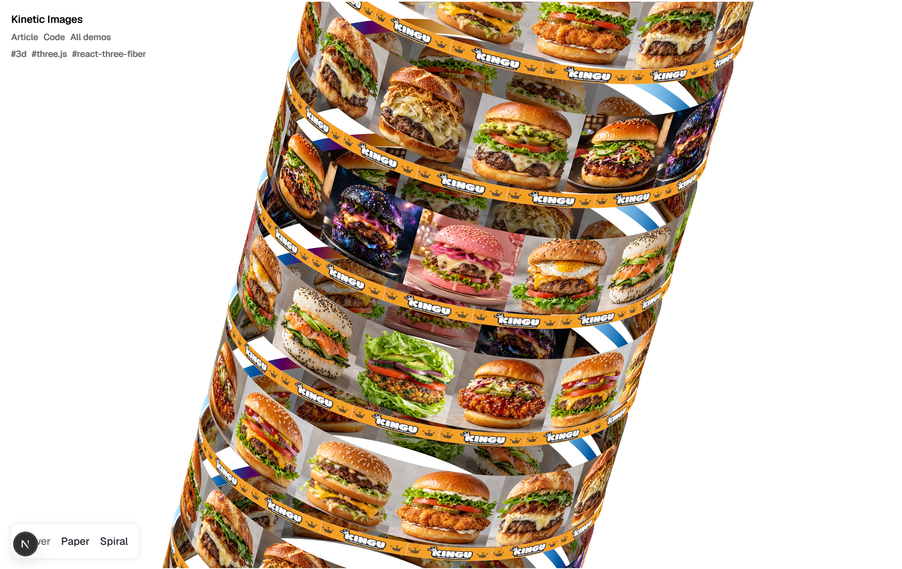

# Kinetic Images — my version

My take on the **Kinetic Images** WebGL demo from [Codrops](https://tympanus.net/codrops/), with my own pictures swapped in.

The pictures move around in 3D, built with [Next.js](https://nextjs.org), [Three.js](https://threejs.org) and [React Three Fiber](https://r3f.docs.pmnd.rs). There are three layouts: the home page, `/paper` and `/spiral`.

## Run it locally

You need [Node.js](https://nodejs.org) installed.

```bash
npm install
npm run dev
```

Then open [http://localhost:3000](http://localhost:3000) in your browser.

## Change the pictures

- **Gallery images:** `public/images/img1.webp` … `img13.webp`. Replace a file with one of the same name, or add new files and list them in `src/data/images.js`.
- **Banner:** `public/banner.jpg`.



https://github.com/user-attachments/assets/caaf343e-ea17-47f0-8ce3-daa720924727

## Build

```bash
npm run build
```

This creates a static version of the site in the `out/` folder.

## Credits

The original demo and code are by [Codrops](https://tympanus.net/codrops/). This repo only changes the images.
